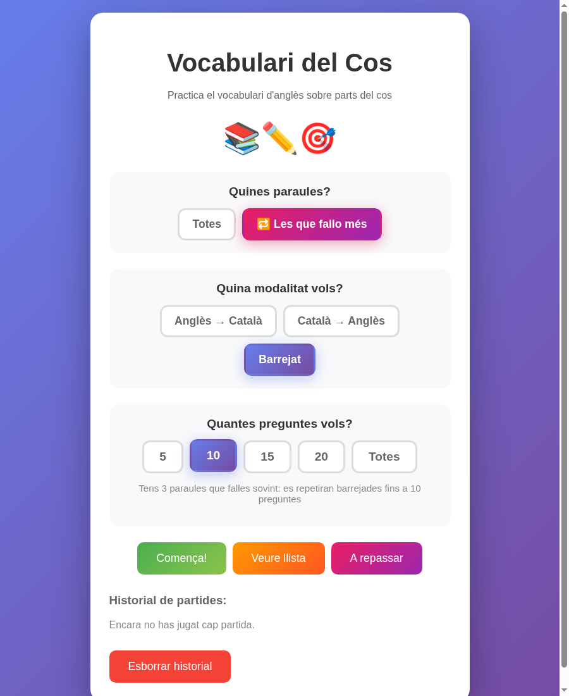
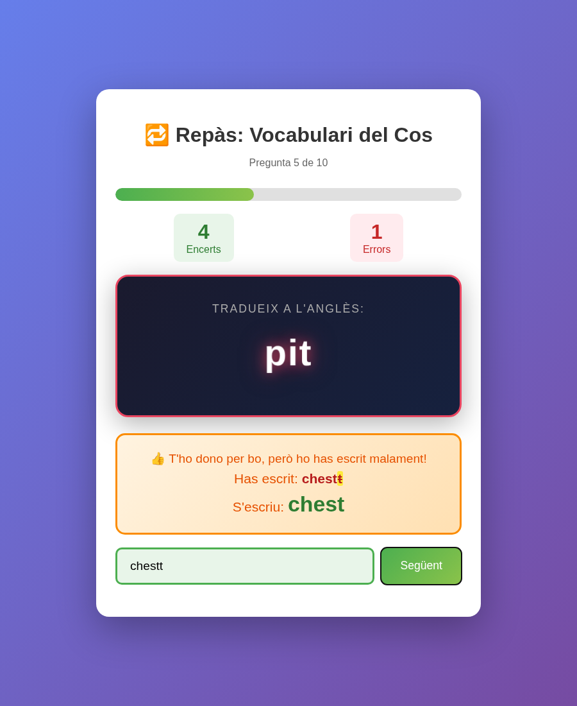
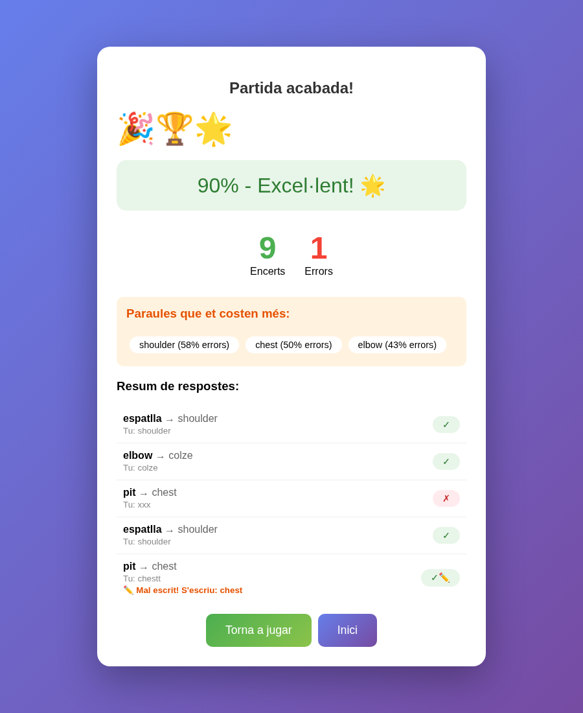

# Joc de Vocabulari Anglès-Català

Joc web interactiu per practicar vocabulari anglès-català. Ideal per preparar exàmens de vocabulari.

## Característiques

- **Tres modalitats**: Anglès→Català, Català→Anglès, o Barrejat
- **Configurable**: Tria el nombre de preguntes (5, 10, 15, 20 o totes)
- **Estadístiques**: Guarda encerts i errors per paraula i direcció
- **Paraules difícils**: Les paraules amb més errors apareixen més sovint
- **Partida de repàs ("Les que fallo més")**: Només pregunta les paraules que falles sovint, i les repeteix fins arribar al nombre de preguntes
- **Tolerant amb errors**: Accepta petits errors d'escriptura i ignora accents
- **Vocabulari extern**: Fàcil de canviar la llista de paraules

## Partida de repàs: "Les que fallo més"

A la pantalla d'inici, a **Quines paraules?**, tria **🔁 Les que fallo més**:

- Entren a la partida les paraules amb almenys 1 error i un **30% d'errors o més**
  (sumant les dues direccions). Les estadístiques es guarden al navegador.
- Si tens **menys** paraules difícils que preguntes (p. ex. 3 paraules i 10 preguntes),
  el joc les repeteix en rondes desordenades fins arribar a 10. Cada paraula surt un
  nombre de vegades semblant i mai dues vegades seguides.
- Si en tens **més** que preguntes, fa les pitjors (les que tenen més errors).
- **Totes** fa una pregunta per a cada paraula difícil.
- En mode **Barrejat**, pregunta més en la direcció on el nen falla més.
- Si encara no hi ha paraules difícils, el joc ho diu i cal jugar primer una partida normal.

| Inici | Pregunta | Resum |
|---|---|---|
|  |  |  |

## Com usar-lo

### 1. Crear o editar la llista de paraules

Edita el fitxer `vocabulari.yaml` amb qualsevol editor de text. El format és:

```yaml
titulo: El títol del vocabulari
descripcion: Una breu descripció

paraules:
  - en: cat
    ca: [gat]

  - en: dog
    ca: [gos, gossa]

  - en: house
    ca: [casa]
    altEn: [home]  # alternatives en anglès (opcional)
```

**Camps:**
- `titulo`: El títol que es mostrarà al joc
- `descripcion`: Descripció que apareix sota el títol
- `paraules`: Llista de paraules
  - `en`: Paraula en anglès (obligatori)
  - `ca`: Llista de traduccions en català acceptades (obligatori)
  - `altEn`: Llista d'alternatives en anglès (opcional)

**Consells:**
- Posa diverses traduccions si una paraula té sinònims: `ca: [gos, gossa, gossot]`
- Usa `altEn` per acceptar diferents formes: `altEn: [pajamas]` per a `pyjamas`
- Els accents i majúscules s'ignoren automàticament

### 2. Llençar el servidor web

#### Opció recomanada (Linux / WSL): `./http-server`

El repo porta un servidor web propi escrit en Rust (`./http-server`). És un binari
estàtic de Linux x86_64, **sense cap dependència** (no cal Python ni res més):

```bash
cd /ruta/al/joc-vocabulari-angles
./http-server                      # escolta a 0.0.0.0:54321 i serveix la carpeta actual
./http-server --port 8000          # un altre port
./http-server --bind 127.0.0.1     # només aquest ordinador
./http-server --dir altra/carpeta  # una altra carpeta
```

Valors per defecte: `--bind 0.0.0.0`, `--port 54321`, `--dir .`. Obre el navegador a
`http://IP_DE_L_ORDINADOR:54321`.

Envia `Cache-Control: no-cache`: quan canvies de branca o de vocabulari, n'hi ha prou
de recarregar la pàgina.

Per recompilar-lo (cal `rustup target add x86_64-unknown-linux-musl`):

```bash
cd rust-http-server
cargo build --release --target x86_64-unknown-linux-musl
cp target/x86_64-unknown-linux-musl/release/http-server ../http-server
```

Si no pots compilar-lo, baixa el binari ja fet de la
[pàgina de releases](https://github.com/oriolrius/joc-vocabulari-angles/releases/latest):

| Sistema | Fitxer |
|---|---|
| Linux x86_64 | `http-server-x86_64-unknown-linux-musl` |
| Linux ARM64 (Raspberry Pi 64 bits) | `http-server-aarch64-unknown-linux-musl` |
| Windows x86_64 | `http-server-x86_64-pc-windows-msvc.exe` |
| Windows ARM64 | `http-server-aarch64-pc-windows-msvc.exe` |
| macOS Intel | `http-server-x86_64-apple-darwin` |
| macOS Apple Silicon | `http-server-aarch64-apple-darwin` |

A Linux i macOS: `chmod +x http-server-*`. A macOS, la primera vegada potser cal
`xattr -d com.apple.quarantine http-server-*`.

El workflow `.github/workflows/release.yml` genera aquests binaris. Corre sol quan
puges un tag `v*` (`git tag -a v0.3.0 -m v0.3.0 && git push origin v0.3.0`). Per tornar
a generar-los per a un tag que ja existeix: Actions → *Release binaris* → *Run workflow*.

#### Altres opcions (Python, Node.js)


El joc necessita un servidor web per carregar el fitxer YAML. Aquí tens les instruccions per a cada sistema operatiu:

---

#### Linux

```bash
cd /ruta/al/joc-vocabulari-angles
sudo python3 -m http.server 80
```

O sense permisos de root (port 8000):
```bash
python3 -m http.server 8000
```

Obre el navegador a: `http://localhost` (o `http://localhost:8000`)

---

#### macOS

```bash
cd /ruta/al/joc-vocabulari-angles
python3 -m http.server 8000
```

O amb permisos d'administrador per usar el port 80:
```bash
sudo python3 -m http.server 80
```

Obre el navegador a: `http://localhost:8000` (o `http://localhost`)

---

#### Windows + WSL (recomanat)

1. Obre una terminal WSL (Ubuntu, Debian, etc.)
2. Navega a la carpeta del joc:
```bash
cd /mnt/c/Users/NomUsuari/Documents/joc-vocabulari-angles
```
3. Llença el servidor:
```bash
python3 -m http.server 8000
```

Obre el navegador a: `http://localhost:8000`

---

#### Windows (sense WSL)

**Opció 1: Python**

1. Instal·la Python des de https://www.python.org/downloads/
2. Obre el Command Prompt (cmd) o PowerShell
3. Navega a la carpeta del joc:
```cmd
cd C:\Users\NomUsuari\Documents\joc-vocabulari-angles
```
4. Llença el servidor:
```cmd
python -m http.server 8000
```

Obre el navegador a: `http://localhost:8000`

**Opció 2: Node.js**

1. Instal·la Node.js des de https://nodejs.org/
2. Instal·la el servidor:
```cmd
npm install -g http-server
```
3. Navega a la carpeta i llença:
```cmd
cd C:\Users\NomUsuari\Documents\joc-vocabulari-angles
http-server -p 8000
```

---

### 3. Accedir des d'altres dispositius (mòbil, tablet)

Si vols que el nen practiqui des d'un altre dispositiu a la mateixa xarxa:

1. Troba la IP del teu ordinador:
   - **Linux/Mac**: `ip addr` o `ifconfig`
   - **Windows**: `ipconfig`

2. Llença el servidor al port 80:
```bash
sudo python3 -m http.server 80
```

3. Des del mòbil/tablet, obre: `http://IP_DEL_ORDINADOR`
   - Exemple: `http://192.168.1.50`

---

## Estructura de fitxers

```
joc-vocabulari-angles/
├── index.html        # El joc (no cal tocar-lo)
├── http-server       # Servidor web (binari Rust estàtic, sense dependències)
├── rust-http-server/ # Codi font del servidor web
├── vocabulari.yaml   # Llista de paraules (editable)
├── docs/screenshots/ # Captures del README
└── README.md         # Aquest fitxer
```

## Crear múltiples llistes de vocabulari

Pots tenir diverses llistes de vocabulari i canviar entre elles:

1. Crea fitxers com `animals.yaml`, `colors.yaml`, `verbs.yaml`
2. Quan vulguis canviar de llista, renombra o copia:
```bash
cp animals.yaml vocabulari.yaml
```
3. Refresca el navegador

## Esborrar estadístiques

Les estadístiques es guarden al navegador (localStorage). Per esborrar-les:
- Clica "Esborrar historial" a la pantalla d'inici, o
- Obre les eines de desenvolupador del navegador (F12) → Application → Local Storage → Eliminar

## Llicència

MIT License - Lliure per usar, modificar i distribuir.
